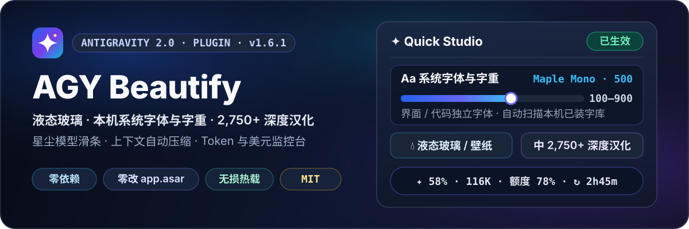
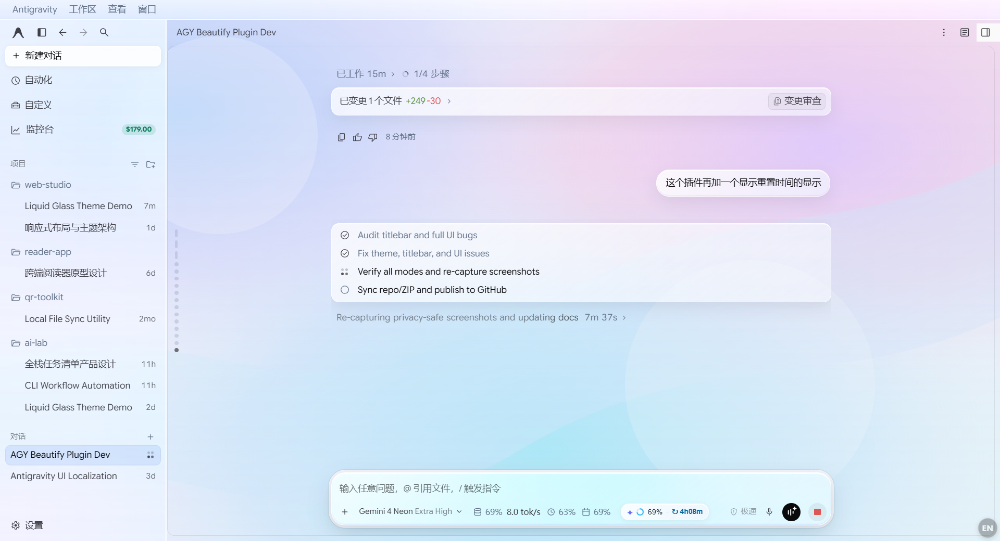
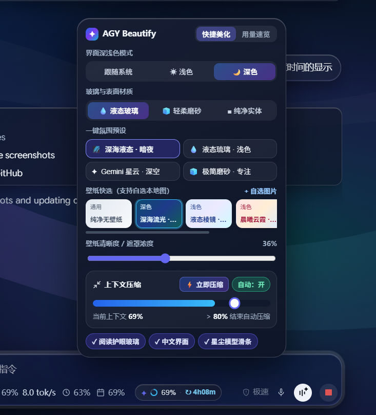
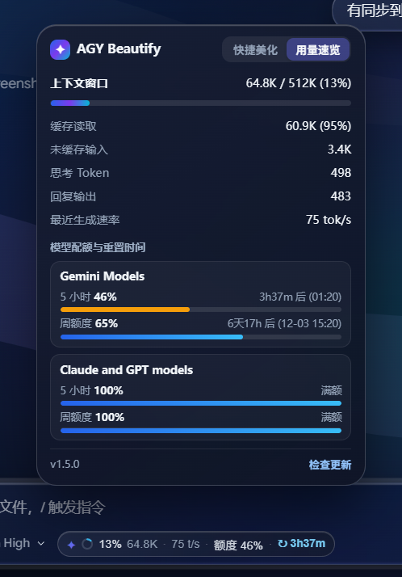
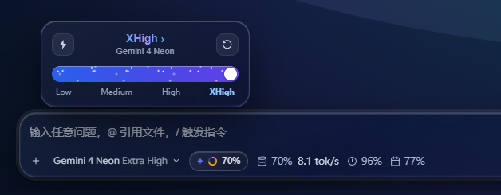
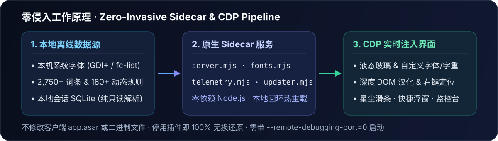

<p align="center">
  
</p>

<p align="center">
  <a href="README.md">简体中文</a> ·
  <a href="README_EN.md">English</a> ·
  <a href="#快速安装与启用">快速安装</a> ·
  <a href="#本版新增增强特性">新增特性</a> ·
  <a href="#致谢与版权声明">版权声明</a>
</p>

**AGY Beautify（增强版）** 是一款专为 **Google Antigravity 2.0** 打造的零依赖原生美化与效率插件：不修改客户端 `app.asar` 与任何安装文件，停用或删除目录即可 100% 无损还原。

> 本仓库基于 [hongyanmo/agy-beautify](https://github.com/hongyanmo/agy-beautify)（MIT）二次开发，整合了 [Silas-02/antigravity-desktop-cn](https://github.com/Silas-02/antigravity-desktop-cn)（MIT）的中文汉化词典与动态规则，并新增**本机系统字体扫描、界面/代码字体与字重（100–900）实时自定义**能力。详见 [致谢与版权声明](#致谢与版权声明)。

---

## 本版新增增强特性（v1.6.0）

- **本机系统字体读取 & 字重实时自定义**：零依赖自动扫描本机已安装字体（Windows GDI+ / macOS & Linux `fc-list`），支持在侧边栏控制台与底栏 `✦` 快捷浮窗分别定制**界面字体、代码/终端等宽字体与 `100–900` 字重**，内置中文/等宽筛选、实时搜索与排版预览，标题粗体按比例联动，严格保护图标字体。
- **2,750+ 词条 & 180+ 动态规则深度汉化**：在原版 118 条词典基础上融合全量 Antigravity 2.0 中文词库，覆盖设置页、插件市场、MCP 服务、定时任务、配额刷新提示、Git 状态、权限审批、侧边栏相对时间与 DOM 下拉菜单；同时修复了原版输入框 `placeholder` 被跳过、90 字符硬截断、未翻译 `title` 提示及 Shadow DOM 菜单漏翻问题。
- **一键更新已指向本仓库**：内置 GitHub Release 更新器默认对接 `auimus/agy-beautify`，升级时完整保留你的壁纸、字体与个人设置。

---

## 实机预览

### 1. 深色 / 浅色液态玻璃主题

<table>
  <tr>
    <td width="50%">
      
      <p align="center">深海液态 · 暗夜模式</p>
    </td>
    <td width="50%">
      
      <p align="center">液态琉璃 · 浅色模式</p>
    </td>
  </tr>
</table>

### 2. 底栏快捷浮窗（壁纸 / 字体字重 / 自动压缩 / 配额倒计时）

<table>
  <tr>
    <td width="54%">
      
      <p align="center">快捷美化 &amp; 自动压缩进度条</p>
    </td>
    <td width="46%">
      
      <p align="center">用量速览、配额重置倒计时 &amp; 检查更新</p>
    </td>
  </tr>
</table>

### 3. Gemini 星尘模型滑条 & 左侧全屏 Token / 美元监控台

<p align="center">
  
</p>

<details>
<summary>展开查看全屏「Token 与美元监控台」三视图截图（总览 / 工具与耗时 / 全部会话）</summary>

#### 总览（6 指标卡 + 14 天趋势 + 环形图 + 20 周热力图 + 模型费用排行）


#### 工具与耗时（Token / 耗时双环形图 + 工具 / 命令 / 技能排行）


#### 全部会话（实时搜索 + 工作区筛选 + 排序 + 点击直达会话）


</details>

---

## 核心功能总览

| 模块 | 功能亮点 |
| --- | --- |
| **系统字体与字重** | 零依赖扫描本机字体，分别定制界面字体、代码/终端等宽字体与 `100–900` 字重；支持搜索、中文/等宽筛选、实时预览与一键还原 |
| **深度中文汉化（zh-CN）** | 2,750+ 精确词条 + 180+ 动态模板，跳过对话正文、代码块、Monaco 编辑器、终端与图标字体；关闭开关即时还原英文 |
| **液态玻璃 & 壁纸工作室** | `跟随系统 / 浅色 / 深色` 一键切换并同步标题栏；支持 `液态玻璃 / 轻柔磨砂 / 纯净实体`、内置 5 套壁纸及拖拽 / `Ctrl+V` / 本地路径导入 |
| **快捷浮窗 & 自动压缩** | 底栏 `✦ xx% · ↻ XhXXm` 实时显示上下文占比与配额重置倒计时；支持手动 `/compact` 与可拖拽阈值（`40%–95%`）对话结束后自动压缩 |
| **Gemini 星尘模型滑条** | 输入框上方悬浮流动星尘滑条切思考强度，支持一键切模型家族与 `⚡` 加速（`Shift+点击` 打开原生菜单） |
| **左侧全屏监控台** | 三视图展示总 Token、美元、缓存节省、14 天趋势、20 周热力图、实时配额与工具/命令/技能耗时排行 |
| **文件右键定位** | 对话内任意文件路径右键一键打开所在文件夹、默认程序打开、复制路径或在终端打开目录 |

---

## 零侵入工作原理

<p align="center">
  
</p>

---

## 快速安装与启用

### 第 1 步：安装插件到 Antigravity 插件目录

**方式一：Git Clone（推荐）**

Windows (PowerShell)：
```powershell
git clone https://github.com/auimus/agy-beautify.git "$env:USERPROFILE\.gemini\config\plugins\agy-beautify"
```

macOS / Linux：
```bash
git clone https://github.com/auimus/agy-beautify.git ~/.gemini/config/plugins/agy-beautify
```

**方式二：下载 Release 压缩包**

前往 [GitHub Releases](https://github.com/auimus/agy-beautify/releases) 下载最新 `agy-beautify-v*.zip`，解压至插件目录，确保存在 `plugin.json`：
- Windows：`%USERPROFILE%\.gemini\config\plugins\agy-beautify\plugin.json`
- macOS / Linux：`~/.gemini/config/plugins/agy-beautify/plugin.json`

### 第 2 步：开启远程调试端口（关键，未开启时界面不生效）

由于本插件采用**零侵入 CDP 注入**（不修改 `app.asar`），Antigravity 客户端需带上 `--remote-debugging-port=0` 参数启动，Electron 才会生成本地 `DevToolsActivePort`：

- **Windows**：右键 Antigravity 桌面/开始菜单快捷方式 → **属性** → 在「目标」末尾追加一个空格和 `--remote-debugging-port=0`，保存后**完全退出并重新打开 Antigravity**；或直接在 PowerShell 运行一键配置：
  ```powershell
  $ws = New-Object -ComObject WScript.Shell
  @("$env:USERPROFILE\Desktop\Antigravity.lnk", "$env:APPDATA\Microsoft\Windows\Start Menu\Programs\Antigravity.lnk") | ForEach-Object {
    if (Test-Path $_) {
      $sc = $ws.CreateShortcut($_)
      if ($sc.Arguments -notmatch '--remote-debugging-port') {
        $sc.Arguments = ($sc.Arguments + ' --remote-debugging-port=0').Trim()
        $sc.Save()
      }
    }
  }
  ```
- **macOS**：
  ```bash
  open -a Antigravity --args --remote-debugging-port=0
  ```
- **Linux**：
  ```bash
  antigravity --remote-debugging-port=0
  ```

重启后打开左侧 **「自定义 / 插件」** 确认启用 **AGY Beautify**，几秒内即可看到界面自动生效，侧边栏控制台右上角将显示 **「已生效」**。

---

## 已知边界与隐私说明

- **关于系统原生右键菜单与顶部系统菜单栏**：由于不修改客户端 `app.asar`，Electron 主进程弹出的 OS 原生菜单（`Menu.popup()`）无法被纯页面侧插件拦截；页面内所有 HTML DOM 菜单、弹窗、设置页与工具栏均可正常汉化。
- **关于字重显示**：`100–900` 滑块对可变字体或多字重字体族（如 `Noto Sans SC`、`Maple Mono`、`Cascadia Code`、`HarmonyOS Sans SC` 等）表现最细腻；单字重字体会由系统自动映射到最近可用字重。
- **100% 本地离线**：所有 Token、美元、耗时与系统字体扫描均在本地完成，不向第三方上传对话或隐私数据（仅检查更新时请求 GitHub Releases）。

---

## 目录结构与测试

```text
agy-beautify/
├── plugin.json                      # Antigravity 插件清单
├── LICENSE                          # MIT 开源许可（保留原版权声明）
├── THIRD_PARTY_NOTICES.md           # 第三方开源许可与版权归属声明
├── assets/
│   ├── logo.svg                     # 插件图标
│   └── readme/                      # README 原生纯 SVG 视觉资产
├── skills/agy-beautify/SKILL.md     # Agent 技能描述
└── sidecars/beautify_hub/
    ├── sidecar.json                 # Sidecar 注册配置
    ├── server.mjs                   # 侧边栏服务、字体/设置 API 与热重载
    ├── injector.mjs                 # CDP 实时注入引擎（玻璃/字体字重/汉化/滑条/监控台/压缩）
    ├── fonts.mjs                    # 跨平台零依赖本机系统字体扫描与 CSS 栈构建
    ├── i18n_dict.mjs                # 汉化词典融合与 180+ 动态匹配规则
    ├── i18n_upstream.json           # 整合自 antigravity-desktop-cn 的 2,722 条词库
    ├── telemetry.mjs                # 本地 SQLite 会话解析
    ├── settings.mjs                 # 设置持久化、预设与壁纸管理
    ├── path_utils.mjs               # 跨平台本地路径解析与文件管理器定位
    ├── updater.mjs                  # GitHub Release 检测、SHA-256 校验与原子热更新
    ├── ui_html.mjs & ui_script.mjs  # 侧边栏美化与字体控制台界面
    └── beautify.test.mjs            # Node 原生单元测试
```

运行内置单元测试（无需安装任何依赖）：
```bash
node --test sidecars/beautify_hub/beautify.test.mjs
```

---

## 致谢与版权声明

本项目遵循 **MIT License** 开源，完整保留所有上游项目的版权声明与许可条款（详见 [LICENSE](LICENSE) 与 [THIRD_PARTY_NOTICES.md](THIRD_PARTY_NOTICES.md)）：

- **[hongyanmo/agy-beautify](https://github.com/hongyanmo/agy-beautify)**（MIT License，`Copyright (c) 2026 Kaora (hongyanmo)`）：本项目的上游基础仓库，提供了原生 Sidecar 架构、液态玻璃主题、壁纸工作室、Gemini 星尘滑条、自动压缩、Token 监控台与右键文件定位等核心能力。
- **[Silas-02/antigravity-desktop-cn](https://github.com/Silas-02/antigravity-desktop-cn)**（MIT License，`Copyright (c) 2026 Silas-02`、`qqxpee`、`Antigravity Chinese Localization Contributors`）：本版深度中文词典（`i18n_upstream.json`）及部分动态文案匹配规则基于该项目的开源汉化词库整合与适配。
- **字体与商标声明**：本仓库不包含或二次分发任何商业/第三方字体文件，所有系统字体均由插件在用户本机实时读取；`Google`、`Antigravity`、`Gemini` 均为 Google LLC 的注册商标，本项目为独立社区插件。
