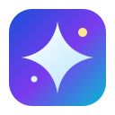
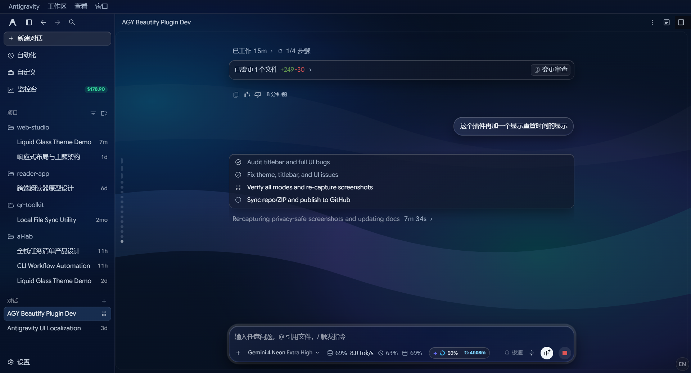
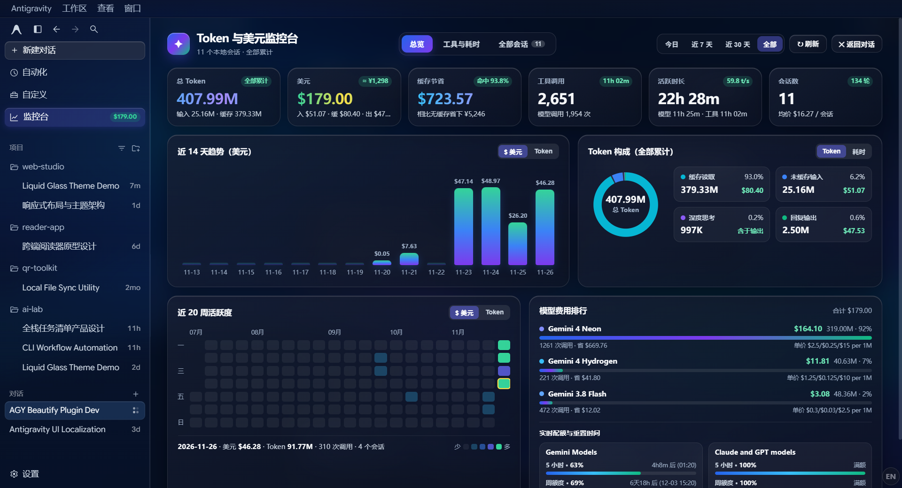
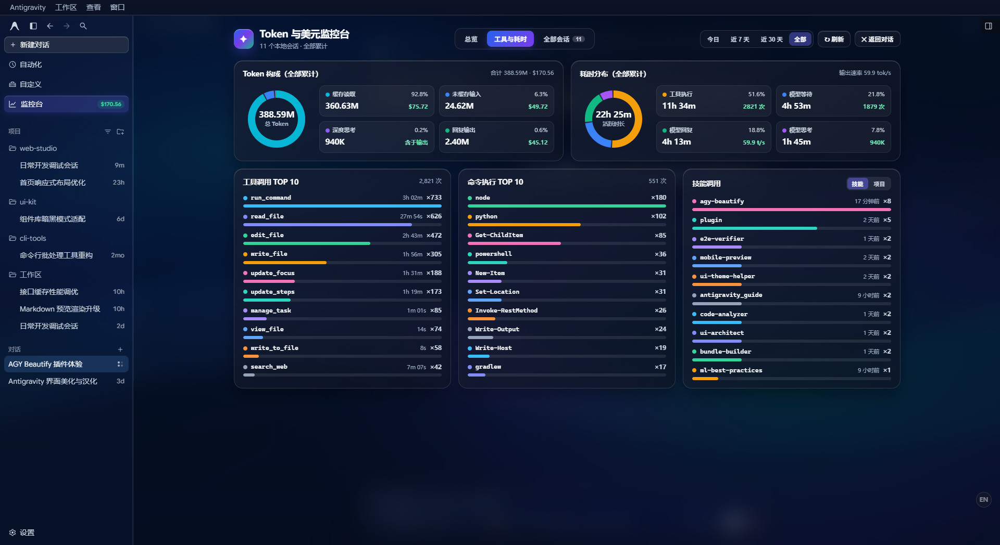
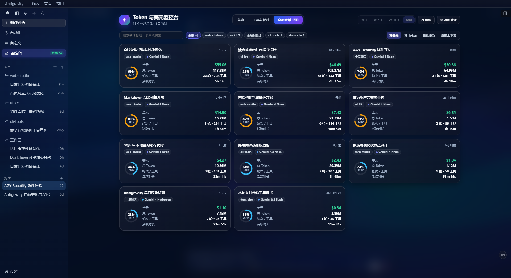

<div align="center">
  
  <h1>AGY Beautify</h1>
  <p><strong>Google Antigravity 2.0 全能美化、液态玻璃、自动压缩上下文与 Token/美元监控插件</strong></p>
  <p>
    <a href="README.md">简体中文</a> ·
    <a href="README_EN.md">English</a>
  </p>
  <p>
    
    
    
    
  </p>
</div>

---

**AGY Beautify** 是一款专为 **Google Antigravity 2.0** 打造的纯原生一站式美化与效率插件：不修改客户端 `app.asar` 与任何安装文件，零第三方依赖，打包不到 100 KB，卸载或关闭开关即可 100% 无损还原。

## 核心功能一览

| 模块 | 功能亮点 |
| --- | --- |
| **液态玻璃 & 深浅色主题** | `跟随系统 / 浅色 / 深色` 一键切换，自动同步 Windows 原生标题栏窗口控件与深浅色壁纸配对；支持 `液态玻璃 / 轻柔磨砂 / 纯净实体` 三种表面材质与阅读护眼玻璃底板 |
| **壁纸工作室** | 内置 5 套浅/深双风格壁纸，支持本地选图、拖拽导入、`Ctrl+V` 粘贴截图、本地路径导入与遮罩微调 |
| **快捷浮窗、重置倒计时 & 自动压缩** | 底栏 `✦ xx% · ↻ XhXXm` 胶囊实时显示上下文占比与配额重置倒计时；点开即可实时切换样式、查看 5 小时/周额度与重置时间，并内置手动 `/compact` 与 **可拖拽阈值进度条（40%–95%）** |
| **Gemini 星尘模型滑条** | 自动屏蔽原生冗长下拉菜单，在输入框上方悬浮流动星尘滑条切思考强度，支持一键切模型家族与 `⚡` 加速（`Shift+点击` 开原生菜单） |
| **左侧全屏「Token 与美元监控台」** | 分「总览 / 工具与耗时 / 全部会话」三视图，展示总 Token、美元、缓存节省、14 天趋势、Token/耗时环形图、20 周热力图、实时配额与重置时间、工具/命令/技能排行与可搜索会话卡片 |
| **自动中文汉化 & 右键文件定位** | 开箱即用简体中文界面（跳过对话正文与代码块）；对话内任意文件右键支持打开所在文件夹、默认程序打开、复制路径与在终端打开目录 |

---

## 实机预览

### 1. 深色 / 浅色液态玻璃主题

<table>
  <tr>
    <td width="50%">
      
      <p align="center">深海液态 · 暗夜模式</p>
    </td>
    <td width="50%">
      
      <p align="center">液态琉璃 · 浅色模式</p>
    </td>
  </tr>
</table>

### 2. 底栏快捷美化浮窗 & 上下文自动压缩进度条

所有外观开关、材质切换、预设与壁纸均实时生效；下方内置 **上下文压缩卡片**，支持手动 `⚡ 立即压缩` 以及左右拖动圆点设定触发阈值（例如拖到 `70%`，上下文超过 `70%` 且本轮对话结束后自动执行 `/compact`）。

<p align="center">
  
</p>

### 3. Gemini 星尘模型与思考强度滑条

<p align="center">
  
</p>

### 4. 左侧全屏「Token 与美元监控台」（三视图）

#### 总览（6 指标卡 + 14 天趋势 + 环形图 + 20 周热力图 + 模型费用排行）


#### 工具与耗时（Token/耗时双环形图 + 工具调用 / 命令执行 / 技能调用排行）


#### 全部会话（实时搜索 + 工作区筛选 + 排序 + 上下文环形图 + 点击直达会话）


---

## 快速安装

### 方式一：Git Clone 直接安装（推荐）

**Windows (PowerShell)：**
```powershell
git clone https://github.com/hongyanmo/agy-beautify.git "$env:USERPROFILE\.gemini\config\plugins\agy-beautify"
```

**macOS / Linux：**
```bash
git clone https://github.com/hongyanmo/agy-beautify.git ~/.gemini/config/plugins/agy-beautify
```

### 方式二：下载 Release 压缩包手动安装

1. 前往本仓库的 **Releases** 页面下载 `agy-beautify-v1.4.0.zip`。
2. 解压到 Antigravity 插件目录，确保目录结构如下：
   - Windows: `%USERPROFILE%\.gemini\config\plugins\agy-beautify\plugin.json`
   - macOS / Linux: `~/.gemini/config/plugins/agy-beautify/plugin.json`
3. 重启或打开 Antigravity，在左侧 **「自定义 / 插件」** 中启用 **AGY Beautify** 即可生效。

---

## 目录结构

```text
agy-beautify/
├── plugin.json                      # Antigravity 插件清单
├── assets/logo.svg                  # 插件图标
├── skills/agy-beautify/SKILL.md     # Agent 技能描述
├── sidecars/beautify_hub/
│   ├── sidecar.json                 # Sidecar 注册配置
│   ├── server.mjs                   # 侧边栏控制台服务与 CDP 桥接
│   ├── injector.mjs                 # 页面实时注入引擎（液态玻璃/星尘滑条/浮窗/监控台/自动压缩/汉化/右键）
│   ├── telemetry.mjs                # 本地 SQLite 会话解析（Token/美元/耗时/工具/命令/技能/热力图）
│   ├── settings.mjs                 # 设置持久化、预设方案与壁纸管理
│   ├── i18n_dict.mjs                # 简体中文界面词典
│   ├── path_utils.mjs               # 跨平台本地路径解析与文件管理器定位
│   ├── ui_html.mjs & ui_script.mjs  # 侧边栏美化控制台界面
│   └── beautify.test.mjs            # Node 原生单元测试
└── docs/screenshots/                # README 预览截图
```

---

## 运行单元测试

本插件使用 Node.js 内置测试模块，无需安装任何依赖：

```bash
node --test sidecars/beautify_hub/beautify.test.mjs
```

---

## 隐私与安全说明

- **100% 本地离线**：监控台展示的所有 Token、美元费用、工具调用、命令统计与会话记录，均直接只读解析自你本机的 Antigravity SQLite 文件，**不会向任何第三方服务器发送数据**。
- **零侵入可逆**：不修改 Antigravity 客户端安装目录或 `app.asar`；关闭插件开关或删除插件文件夹即可完全恢复原生界面。
- **费用说明**：监控台中的美元费用基于主流模型公开 API 单价结合本机真实 Token 消耗记录计算，便于直观感知用量与缓存节省。

---

## License

[MIT License](LICENSE)
