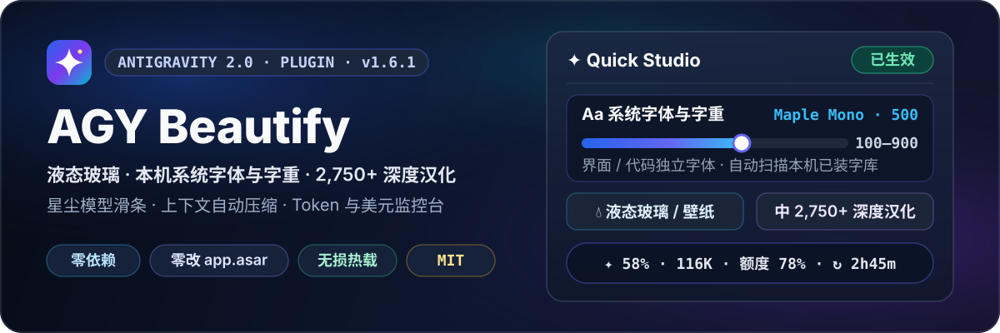
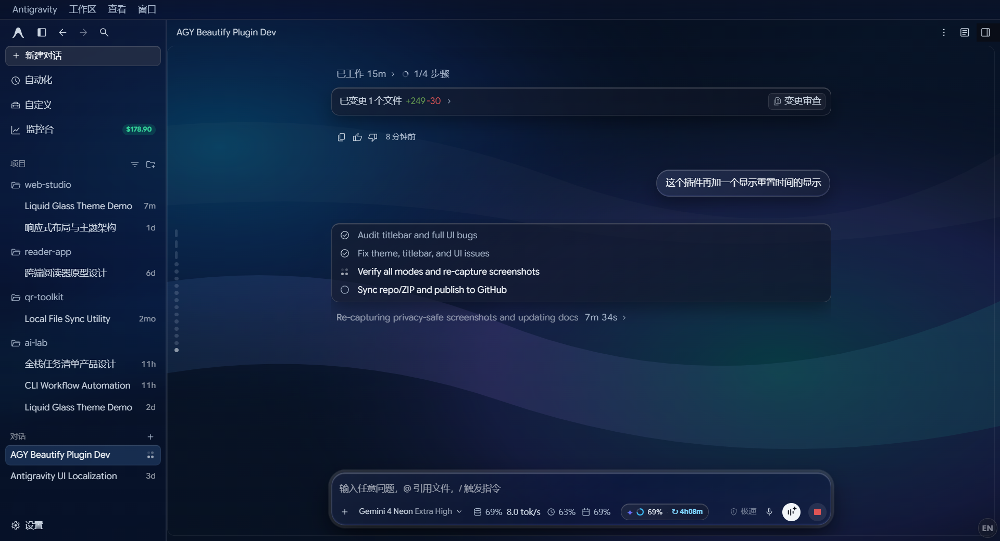
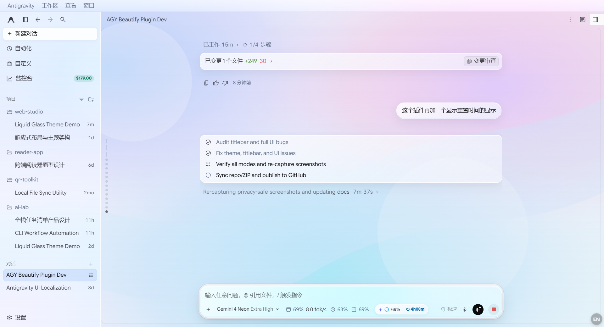
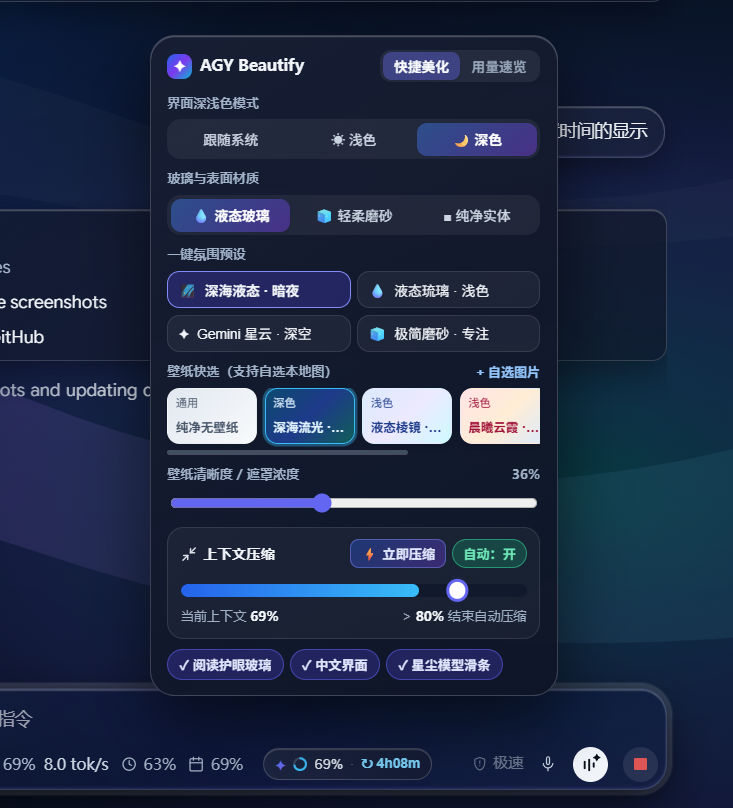
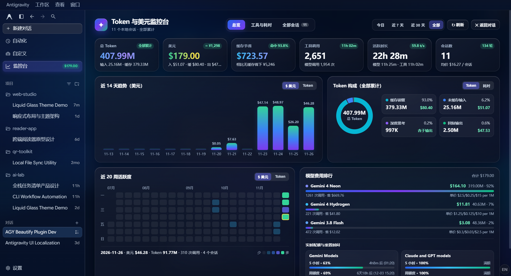
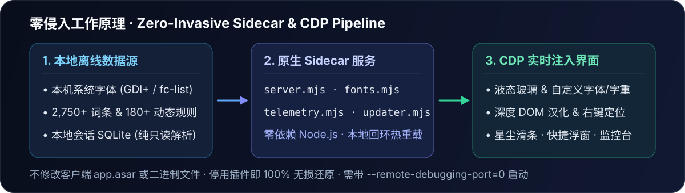

<p align="center">
  
</p>

<p align="center">
  <a href="README.md">简体中文</a> ·
  <a href="README_EN.md">English</a> ·
  <a href="#installation--setup">Installation</a> ·
  <a href="#whats-new-in-this-edition-v160">What's New</a> ·
  <a href="#credits--license">License</a>
</p>

**AGY Beautify (Enhanced Edition)** is a zero-dependency, non-invasive native plugin for **Google Antigravity 2.0**. It never modifies `app.asar` or your Antigravity installation — disable or remove the plugin folder anytime for a 100% clean revert.

> Built upon [hongyanmo/agy-beautify](https://github.com/hongyanmo/agy-beautify) (MIT) with expanded zh-CN localization dictionaries adapted from [Silas-02/antigravity-desktop-cn](https://github.com/Silas-02/antigravity-desktop-cn) (MIT), plus native system font scanning and live UI/code font family & weight (`100–900`) customization. See [Credits & License](#credits--license) and [THIRD_PARTY_NOTICES.md](THIRD_PARTY_NOTICES.md).

---

## What's New in This Edition (v1.6.0)

- **System Font Scanner & Live Font Weight (`100–900`)**: Zero-dependency OS font enumeration (Windows GDI+ / macOS & Linux `fc-list`) with separate controls for UI font, code/terminal monospace font, and weight in both the Sidebar panel and Quick Studio popover — featuring live search, CJK/Mono filters, real-time typography preview, proportional bold scaling, and strict icon-font protection.
- **2,750+ Entry & 180+ Pattern Chinese Localization**: Merges upstream Antigravity 2.0 UI translations covering settings, marketplace plugins, MCP servers, automations, quota refresh notices, Git actions, permission prompts, sidebar timestamps, and DOM menus — while fixing skipped `input`/`textarea` placeholders, raising the 90-char cutoff, adding `title` tooltip support, and traversing Shadow DOM menus.
- **Self-Update Pointed to This Fork**: Built-in GitHub Release updater checks `auimus/agy-beautify` Releases and preserves all user settings, custom fonts, and wallpapers.

---

## Visual Preview

<table>
  <tr>
    <td width="50%">
      
      <p align="center">Deep Ocean Liquid Glass · Dark</p>
    </td>
    <td width="50%">
      
      <p align="center">Liquid Prism · Light</p>
    </td>
  </tr>
  <tr>
    <td width="50%">
      
      <p align="center">Quick Studio &amp; Auto-Compact Bar</p>
    </td>
    <td width="50%">
      
      <p align="center">Full-Pane Token &amp; USD Monitor</p>
    </td>
  </tr>
</table>

---

## Architecture

<p align="center">
  
</p>

---

## Installation & Setup

### 1. Install into the Antigravity Plugins Directory

**Option A: Git Clone (Recommended)**

Windows (PowerShell):
```powershell
git clone https://github.com/auimus/agy-beautify.git "$env:USERPROFILE\.gemini\config\plugins\agy-beautify"
```

macOS / Linux:
```bash
git clone https://github.com/auimus/agy-beautify.git ~/.gemini/config/plugins/agy-beautify
```

**Option B: Release ZIP**

Download the latest `agy-beautify-v*.zip` from [GitHub Releases](https://github.com/auimus/agy-beautify/releases) and extract it so `plugin.json` is located at:
- Windows: `%USERPROFILE%\.gemini\config\plugins\agy-beautify\plugin.json`
- macOS / Linux: `~/.gemini/config/plugins/agy-beautify/plugin.json`

### 2. Launch Antigravity with `--remote-debugging-port=0` (Required)

Because this plugin injects purely via CDP without patching `app.asar`, Antigravity must be launched with `--remote-debugging-port=0` so Electron writes `DevToolsActivePort`:

- **Windows**: Add `--remote-debugging-port=0` to your Antigravity Desktop / Start Menu shortcut **Target** field, then fully quit and relaunch Antigravity.
- **macOS**: `open -a Antigravity --args --remote-debugging-port=0`
- **Linux**: `antigravity --remote-debugging-port=0`

Enable **AGY Beautify** under **Customizations / Plugins** and open the sidebar panel to confirm the status badge shows **Active (`已生效`)**.

---

## Known Boundaries & Privacy

- **Native OS Context Menus**: Native Electron `Menu.popup()` right-click menus and OS menu bars are controlled by the Electron main process and cannot be intercepted without modifying `app.asar`. All in-page HTML DOM menus, dialogs, and panels are localized.
- **100% Local & Offline**: Token, USD, timing, and font scans run locally on your machine. No conversation content is sent externally (only GitHub Releases is queried when checking for updates).

## Tests

```bash
node --test sidecars/beautify_hub/beautify.test.mjs
```

---

## Credits & License

Licensed under the [MIT License](LICENSE). All upstream copyright notices are preserved in [LICENSE](LICENSE) and [THIRD_PARTY_NOTICES.md](THIRD_PARTY_NOTICES.md):

- **[hongyanmo/agy-beautify](https://github.com/hongyanmo/agy-beautify)** — MIT License (`Copyright (c) 2026 Kaora (hongyanmo)`): Upstream plugin foundation (Liquid Glass engine, wallpaper studio, Gemini Starlight picker, Token & USD monitor, auto-compact, file reveal, and updater).
- **[Silas-02/antigravity-desktop-cn](https://github.com/Silas-02/antigravity-desktop-cn)** — MIT License (`Copyright (c) 2026 Silas-02`, `qqxpee`, `Antigravity Chinese Localization Contributors`): Source of the expanded zh-CN UI dictionary (`i18n_upstream.json`) and adapted dynamic localization patterns.
- **Fonts & Trademarks**: No third-party or commercial font binaries are bundled in this repository; fonts are enumerated directly from the user's local OS. "Google", "Antigravity", and "Gemini" are trademarks of Google LLC.
